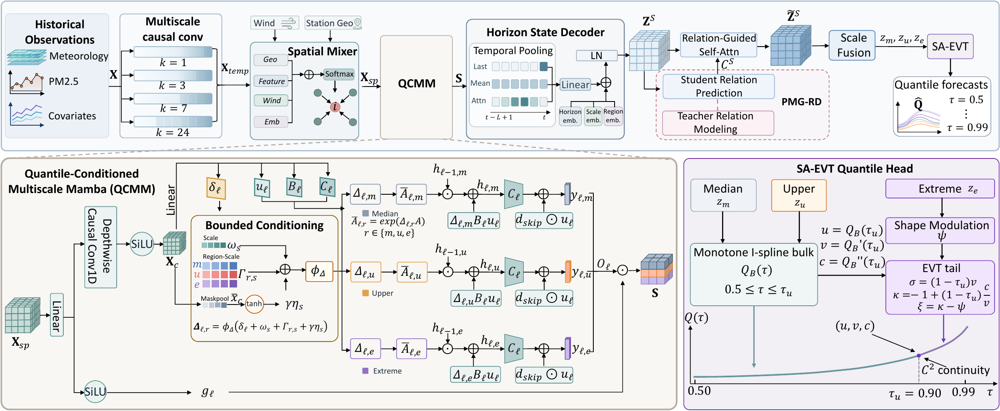

# AirTail

This repository contains the PyTorch implementation of **AirTail: Quantile-Conditioned Multiscale State Modeling for Tail-Aware PM₂.₅ Forecasting**.

AirTail consists of three components, **QCMM**, **PMG-RD**, and **SA-EVT**.

[](fig/framework.pdf)

## Requirements

- Python >= 3.10
- CUDA-enabled PyTorch and the matching Mamba selective-scan extension

```bash
pip install -r requirements.txt
pip install -e .
```

## Data Preparation

Download the datasets from [Google Drive](https://drive.google.com/drive/folders/122qhlnZHPcZR_qM4r5mE2mXtDAKk4QCQ) and place them under `data/BTHSA/`, `data/YRD/`, and `data/gansuair/`. Expected filenames are listed in `configs/datasets/`.

## Train and Evaluation

Run the following commands from the repository root in order. Each training stage automatically saves its best model in the output directory for the next step.

**BTHSA — Teacher training**

```bash
python -m airtail train-teacher --config configs/teacher.yaml --data-config configs/datasets/bthsa.json --output-dir outputs/teacher
```

**BTHSA — Student training**

```bash
python -m airtail train-student --config configs/student.yaml --data-config configs/datasets/bthsa.json --teacher-checkpoint outputs/teacher/best_relation_teacher.pt --output-dir outputs/student
```

**BTHSA — Evaluation**

```bash
python -m airtail evaluate --config configs/student.yaml --data-config configs/datasets/bthsa.json --checkpoint outputs/student/best_relation_student.pt --output-dir outputs/test --split test --paper-metrics
```
